# Site Filter Proxy — Architecture

> This document describes **how the system works**. It is the technical basis of the project.
> The phases, tasks and decisions are in [PLAN.md](PLAN.md).

---

## 1. The idea in one sentence

Every website the browser tries to open first goes to a small **client app** on the user's computer.
The client asks a **filter server** (on another machine) *"is this site allowed?"*. The server checks
its **blocklist database**, writes a **log entry**, and answers **allow** or **block**. The client then
opens the site or shows a block page.

---

## 2. The big picture

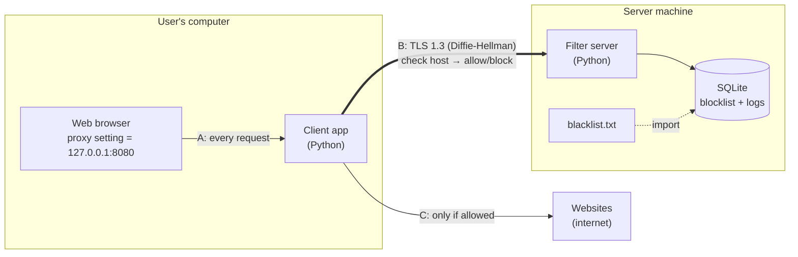

**Important:** the server **never touches website traffic**. It only receives a *site name* and returns a *decision*.
The client opens the connection to the website itself.

---

## 3. The three connections (and their ports)

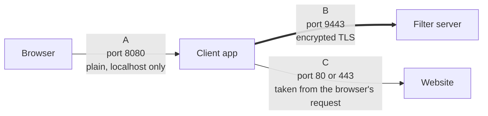

| | Connection | Port | Who decides the port | Encrypted? |
|---|---|---|---|---|
| **A** | Browser → Client app | `8080` | You, in the browser's proxy settings | No (never leaves the computer) |
| **B** | Client app → Filter server | `9443` | You, in the config files | **Yes — TLS 1.3** |
| **C** | Client app → Website | `80` / `443` | The browser (`http://` = 80, `https://` = 443) | HTTPS sites: yes, end-to-end between browser and site |

* Only the **site name** travels on B. The port of C is never sent to the server.
* The client allows only ports **80 and 443** on C. Any other port is refused.

---

## 4. Components

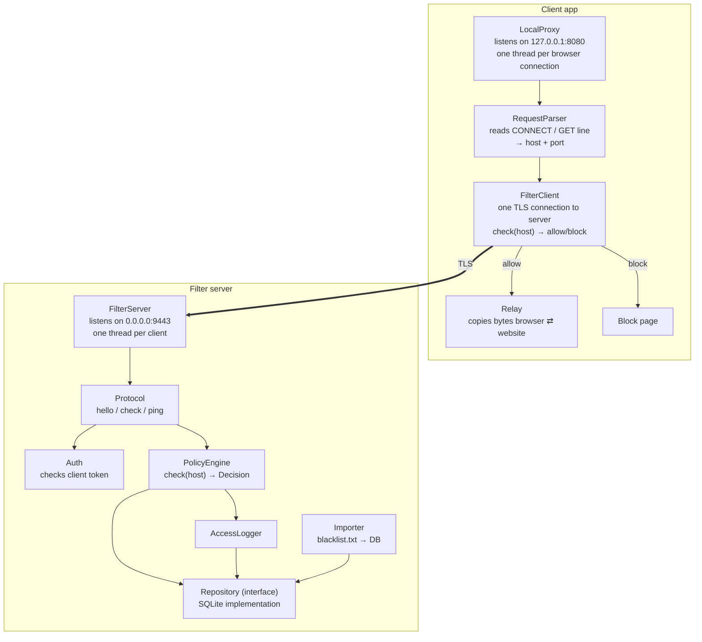

### Client app

| Part | Job |
|---|---|
| **LocalProxy** | Accepts connections from the browser on `127.0.0.1:8080`. Starts a thread for each one. |
| **RequestParser** | Reads the first line the browser sends and gets the `host` and `port`. |
| **FilterClient** | Keeps **one TLS connection** to the server. `check(host)` sends a question and **waits on the socket** for the answer. A lock makes sure only one question at a time travels on the socket. If the connection drops, it reconnects. |
| **Relay** | When the site is allowed, opens connection C to the website and copies bytes in both directions until one side closes. |
| **Block page** | When the site is blocked, sends the browser `403 Forbidden` (and an HTML page for `http://` sites). |

### Filter server

| Part | Job |
|---|---|
| **FilterServer** | Accepts TLS connections from clients on port `9443`. One thread per client. (`server/tls_server.py`) |
| **Protocol** | Reads and writes the JSON-line messages (see section 6). |
| **Auth** | The first message must be `hello` with a valid client token, otherwise the connection is closed. |
| **PolicyEngine** | Decides allow/block for a host (see section 7). Does **not** know about sockets or SQL. |
| **Repository** | The only part that talks to the database. Defined as an interface, implemented with SQLite. |
| **AccessLogger** | Writes one row per `check` into `access_log`. |
| **Importer** | Loads `blacklist.txt` into the database. |

**Layering rule:** sockets → protocol → policy → repository → database. Each layer only calls the one below it.
This is what lets us add a dashboard or external blocklist sources later without changing the network code.

---

## 5. Request flows

### 5.1 Client start-up (TLS handshake + login)

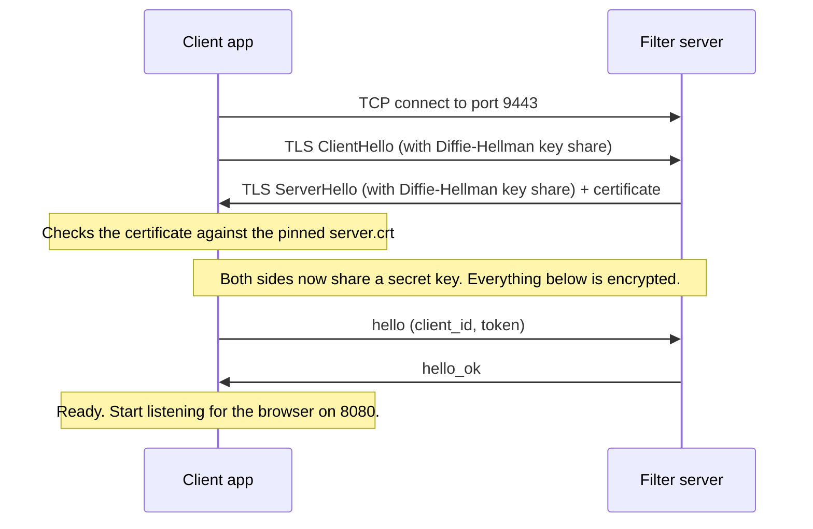

### 5.2 Allowed HTTPS site

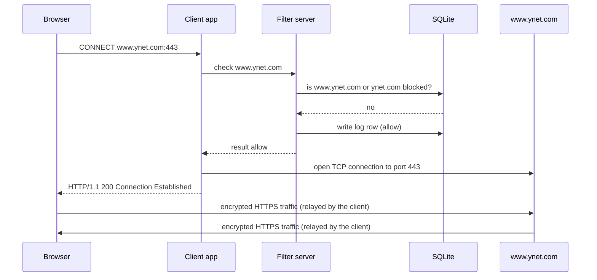

### 5.3 Blocked site

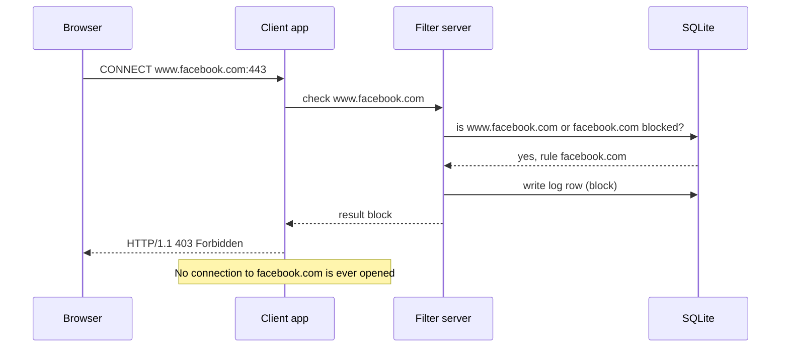

### 5.4 Server not reachable (Phase 1)

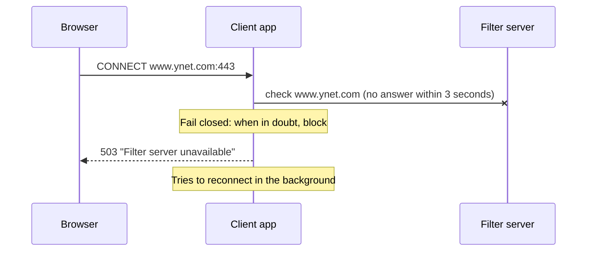

In **Phase 2** the client gets a small cache. When the server is unreachable, the client uses a cached answer
if it has one, and blocks only sites it has never asked about.

### 5.5 One page, many sites

Opening `www.ynet.com` makes the browser load pieces from many site names (images, scripts, ads).

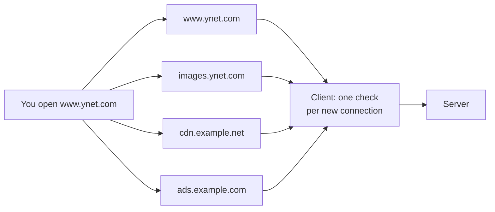

* Pages and images on the **same site name** reuse the browser's connection, so there is **no extra check**.
  For HTTPS the client cannot even see the paths (they are encrypted).
* Each **different site name** is checked once per connection. This means a blocked site is also blocked
  when it is embedded inside another site.
* For plain `http://` the client forces one request per connection (`Connection: close`), so every request
  is checked against the right host.

---

## 6. Protocol on connection B

* Runs **inside TLS**.
* Each message is **one line of JSON**, UTF-8, ending with `\n`.
* Maximum line length: **4096 bytes**. Longer lines → error and disconnect.
* Every request has an `id`; the reply carries the same `id`.

| Direction | Message | Example |
|---|---|---|
| C → S | `hello` | `{"type":"hello","version":1,"client_id":"pc-12","token":"…"}` |
| S → C | `hello_ok` | `{"type":"hello_ok"}` |
| C → S | `check` | `{"type":"check","id":7,"host":"www.ynet.com"}` |
| S → C | `result` | `{"type":"result","id":7,"decision":"allow","rule":null}` |
| S → C | `result` | `{"type":"result","id":8,"decision":"block","rule":"facebook.com"}` |
| C → S | `ping` | `{"type":"ping","id":9}` — "are you there?" (the server supports it; in Phase 1 the client doesn't need it, because it reconnects automatically) |
| S → C | `pong` | `{"type":"pong","id":9}` |
| S → C | `error` | `{"type":"error","id":7,"code":"bad_request","message":"…"}` |

Error codes: `unauthorized`, `bad_request`, `too_long`, `unsupported_version`, `internal`.

Rules:
1. The first message must be `hello`. Anything else → `error unauthorized` and disconnect.
2. A bad `hello` → `error unauthorized` and disconnect (and a log line on the server).
3. The server never sends a message the client did not ask for.

---

## 7. How the server decides

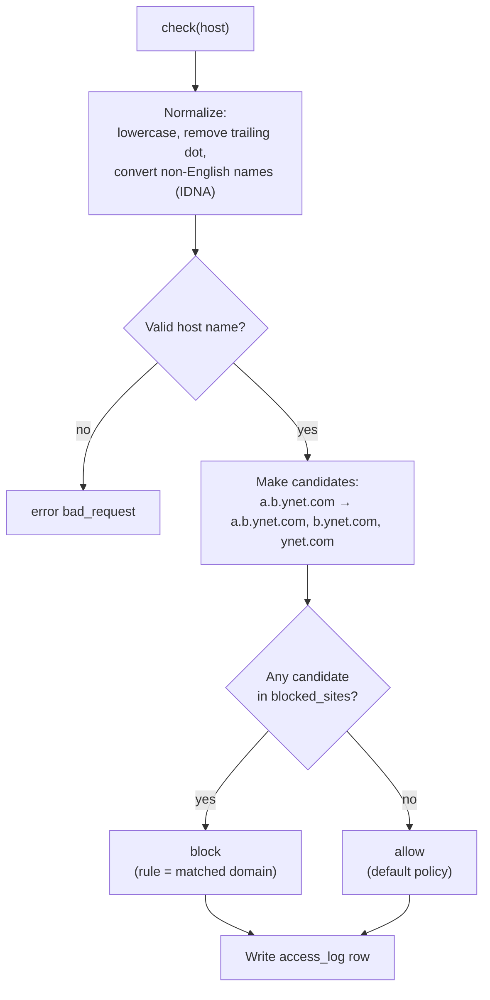

* Blocking `facebook.com` also blocks `www.facebook.com`, `m.facebook.com`, and every other subdomain.
* Blocking `m.facebook.com` does **not** block `www.facebook.com`.
* Default policy: **allow** (it's a blocklist).
* IP addresses (e.g. `142.250.1.1`) are matched exactly.

---

## 8. Database (SQLite)

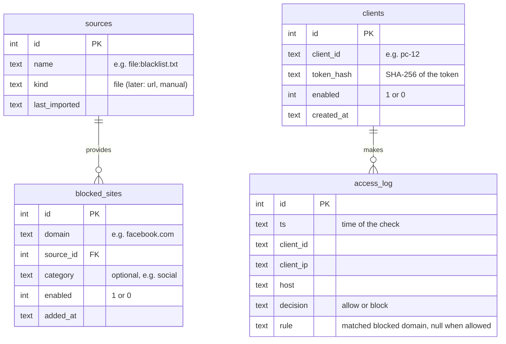

* `blocked_sites` has a unique key on `(domain, source_id)` and an index on `domain`.
* `access_log` has indexes on `ts` and `host` (the future dashboard will search by these).
* `access_log.rule` stores the matched domain as **text** (not a link to `blocked_sites`), so old log rows
  stay correct even after the blocklist is imported again.
* The schema version is stored with `PRAGMA user_version`, so later phases can upgrade the database safely.
* Every thread opens its **own** SQLite connection. All SQL uses `?` placeholders (no SQL injection).

---

## 9. The blocklist file

`data/blacklist.txt` lives **on the server machine only**.

```text
# Social networks
facebook.com
instagram.com
tiktok.com

# Games
example-games.com
```

* One domain per line. `#` starts a comment. Empty lines are ignored.
* Lines that are not valid domain names are skipped and reported.
* Importing **replaces** everything that came from this file (it is the source of truth for the `file:blacklist.txt` source).
* Import runs at server start-up and with the command `python run_server.py import`.
  The server reads the database on each check, so changes take effect immediately.

---

## 10. Security

| Threat | Protection |
|---|---|
| Someone reads the traffic on B | TLS 1.3. The key is agreed with **ephemeral Diffie-Hellman** (ECDHE, X25519), so even a stolen server key can't decrypt old traffic. |
| Someone pretends to be the server (man-in-the-middle) | The server has a certificate. The client trusts **only** that certificate (`server.crt` pinned in the client) and checks the host name. Diffie-Hellman alone does not stop this; the certificate does. |
| A stranger uses the server | Every client must send a valid **token** in `hello`. Tokens are random, stored only as SHA-256 hashes, and compared with `hmac.compare_digest`. |
| The client is used as an open proxy by others | The client listens on `127.0.0.1` only. |
| The client is used to reach non-web services | Connection C allows only ports 80 and 443. |
| Bad or huge input | Max line length, JSON validation, host name validation, socket timeouts. |
| Slow or too many connections (tying up the server) | A new client must finish TLS + login within **10 seconds**; at most **100** clients at the same time. |
| Fake lines in the server log | Text from the client (like a wrong `client_id`) is logged with `repr()`, so new-line characters can't create fake log lines. |
| SQL injection | `?` placeholders only. |
| Private key leaks | `server.key` stays on the server machine, is never committed to git, and has file permissions 600. |

Both sides ask for the **X25519** group explicitly (`common/tls_settings.py`). Without this, new OpenSSL
versions pick a *hybrid* method (X25519 mixed with the post-quantum ML-KEM), which is harder to explain.

How to show the Diffie-Hellman key exchange in the project presentation:
* the client and server print it when connecting, e.g. `TLSv1.3, key exchange x25519, cipher TLS_AES_256_GCM_SHA384`;
* capture connection B in **Wireshark** and point to the `key_share` field in ClientHello/ServerHello
  (step-by-step guide, and a capture tool that needs no admin rights: [TESTING.md](TESTING.md), section 4).

---

## 11. Configuration

`config/server.json`
```json
{
  "listen_host": "0.0.0.0",
  "listen_port": 9443,
  "cert_file": "certs/server.crt",
  "key_file": "certs/server.key",
  "db_file": "data/filter.db",
  "blacklist_file": "data/blacklist.txt",
  "log_file": "data/server.log"
}
```

`config/client.json`
```json
{
  "local_port": 8080,
  "server_host": "192.168.1.50",
  "server_port": 9443,
  "server_cert": "certs/server.crt",
  "client_id": "pc-12",
  "token": "…",
  "check_timeout_seconds": 3,
  "allowed_ports": [80, 443]
}
```

The server certificate is created once with a script (`scripts/make_cert.sh`). Its *Subject Alternative Name*
must contain the server's IP address or host name, otherwise the client will reject it.
Moving the server to the internet later means: new address in `client.json` + a new certificate. No code changes.

---

## 12. Folder layout

```text
YearlyProject/
├── docs/
│   ├── ARCHITECTURE.md      ← this file
│   └── PLAN.md
├── run_server.py            # python run_server.py run | import | add-client | logs
├── run_client.py            # python run_client.py
├── common/                  # shared by client and server
│   ├── config.py            # read a JSON settings file
│   ├── protocol.py          # encode/decode messages, limits, error codes
│   ├── domains.py           # normalize host, build candidate domains
│   └── tls_settings.py      # TLS 1.3 + X25519 Diffie-Hellman settings
├── client/
│   ├── local_proxy.py       # LocalProxy + request parsing
│   ├── filter_client.py     # FilterClient (TLS, lock, reconnect)
│   ├── relay.py             # copy bytes both ways with select()
│   └── block_page.html
├── server/
│   ├── tls_server.py        # FilterServer: TLS + protocol + login
│   ├── policy.py            # PolicyEngine
│   ├── access_logger.py
│   ├── importer.py          # source → database
│   ├── storage/
│   │   ├── base.py          # Repository interface
│   │   ├── sqlite_repo.py
│   │   └── schema.sql
│   └── sources/
│       ├── base.py          # RuleSource interface
│       └── blocklist_file.py
├── config/
│   ├── server.example.json
│   └── client.example.json
├── data/
│   └── blacklist.txt        # example list
├── certs/                   # generated; keys are git-ignored
├── scripts/
│   └── make_cert.sh
├── tools/
│   └── capture_tap.py       # demo: record connection B into a Wireshark file
└── tests/
```

Only the Python standard library is used: `socket`, `ssl`, `threading`, `select`, `sqlite3`, `json`, `hashlib`, `hmac`, `secrets`, `logging`.
Run everything from the project folder (no `pip install` needed).

---

## 13. How the design grows later

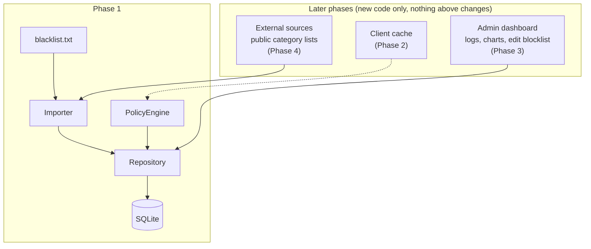

| Future feature | Where it plugs in |
|---|---|
| Client cache | New class inside the client in front of `FilterClient`. The server does not change. |
| Admin dashboard | A new program on the server machine that uses the same `Repository` to read `access_log` and edit `blocked_sites`. |
| External blocklist sources | A new `RuleSource` subclass (e.g. download a public list). Each source gets its own row in `sources`, so it can be refreshed or removed as a group. |
| Different database | A new `Repository` implementation. |

---

## 14. Known limitations

* A user who changes the browser's proxy setting can skip the filter. (True for any proxy-based filter without system-level control.)
* For blocked **HTTPS** sites the browser shows its own error, not our block page, because we do not decrypt HTTPS.
* Filtering is by **site name only**, not by page or content.
* A site opened by its **IP address** (e.g. `https://157.240.1.35`) is only blocked if that IP is in the list.
* Same rules for everyone (by decision).
