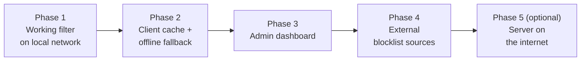

# Site Filter Proxy — Project Plan

> By Itamar. Python, sockets, secure connections, simple database.
> How the system works (diagrams, protocol, database) is in [ARCHITECTURE.md](ARCHITECTURE.md).

---

## 1. Goal

Build a site filter: every user who browses through my proxy is checked against my blocklist
database before a site is opened. Every check is logged. The design must be easy to extend later
with an admin dashboard and external blocklist sources.

## 2. Decisions

| # | Topic | Decision |
|---|---|---|
| 1 | Language | Python 3, standard library only |
| 2 | How users connect | My own **client app** on each computer. The browser's proxy setting points to it (`127.0.0.1:8080`). |
| 3 | Server location | A **different machine**. Same local network in Phase 1; the design must also work over the internet later (config change only). |
| 4 | Server's job | **Only answers allow/block** for a site name. It never carries website traffic. The client opens the website itself. |
| 5 | Secure connection | Client ⇄ server over **TLS 1.3** with Python's `ssl` module. Key exchange = **Diffie-Hellman** (ECDHE), built into TLS 1.3. Server certificate is pinned in the client. |
| 6 | Client authentication | Each client has an id + secret token, sent in the first message. |
| 7 | Filtering type | **Blocklist**: everything is allowed except listed sites. Blocking a domain also blocks its subdomains. |
| 8 | Users | **Same rules for everyone.** |
| 9 | What is checked | Once per **new connection** to a site name (not per page or image). |
| 10 | Allowed ports | Client opens websites only on **80 and 443**. |
| 11 | Blocklist source (Phase 1) | `blacklist.txt` file **on the server machine**, imported into SQLite. Not sent over the network. |
| 12 | Logging | **Required.** Every check (allow and block) is written to the database. Basis for the future dashboard. |
| 13 | Server unreachable | Phase 1: **block** (fail closed). Phase 2: use the client cache, block if never asked before. |
| 14 | Client cache | **Phase 2**, not Phase 1. |
| 15 | Code & tools | Private GitHub repo `shali-mor/YearlyProject`. Work is split into tickets in **Paperclip**. |

## 3. Phases

### Phase 1 — Working filter on the local network

What gets built:
* `common/`: protocol messages and host-name helpers, shared by client and server.
* Server: TLS listener, `hello` login, `check` → allow/block, PolicyEngine, SQLite repository, access log,
  blocklist import, commands `run`, `import`, `add-client`, `logs`.
* Client: local proxy on `127.0.0.1:8080`, request parser (CONNECT and plain HTTP), FilterClient with one
  TLS connection + lock + reconnect, relay, block page, fail-closed when server is unreachable.
* Certificate script, example configs, example `blacklist.txt`, run instructions.
* Unit tests + a two-computer test guide.

**Done when:**
1. On computer X, a browser set to the client can open allowed `http://` and `https://` sites normally.
2. A site in `blacklist.txt` (and its subdomains) is blocked; `http://` shows the block page.
3. Every check appears in `access_log` with time, client, IP, host, decision and matched rule.
4. Stopping the server makes the client block everything with "filter server unavailable"; starting it again recovers without restarting the client.
5. A client with a wrong token is refused and the attempt is logged.
6. Wireshark on connection B shows only TLS 1.3 traffic with a Diffie-Hellman `key_share`.

### Phase 2 — Client cache and offline fallback
* Small cache in the client (site → decision, with an expiry time, e.g. 5 minutes).
* Ask the server only when the site is not in the cache.
* Server unreachable → use the cached answer; never-asked site → block.
* Reconnect with increasing wait times.

### Phase 3 — Admin dashboard
* Runs on the server machine, uses the same Repository.
* Views: latest checks, most blocked sites, activity per client, search by site/time.
* Edit the blocklist from the dashboard (adds a `manual` source).
* Admin login (new `admins` table, passwords hashed with salt).

### Phase 4 — External blocklist sources
* New `RuleSource` types, e.g. download a public category list from a URL.
* Each source has its own row in `sources` and can be refreshed or removed as a group.
* Categories (social, games, …) shown in the dashboard.

### Phase 5 (optional) — Server on the internet
* Public address / port forwarding, certificate for the public host name.
* Rate limiting and lockout after repeated failed logins.

## 4. Phase 1 tickets (Paperclip)

| # | Ticket | Agent | Depends on |
|---|---|---|---|
| 1 | Review ARCHITECTURE.md and PLAN.md; write `common/protocol.py` + `common/domains.py` skeleton and folder layout | CTO | — |
| 2 | Certificate script, example configs, `.gitignore`, example `blacklist.txt`, README run instructions | DevOps | 1 |
| 3 | Server: TLSServer, Protocol, Auth, `python -m server run` | Backend | 1 |
| 4 | Server: Repository (SQLite), schema, PolicyEngine, AccessLogger, Importer, `import` / `add-client` / `logs` commands | Backend 2 | 1 |
| 5 | Client: LocalProxy, RequestParser, FilterClient, Relay, block page, fail-closed | Backend | 1, 3 |
| 6 | Security review of TLS setup, pinning, token handling, input limits, port allowlist | Security | 3, 4, 5 |
| 7 | Unit tests + two-computer test guide; check all "Done when" items | QA | 3, 4, 5 |

Working rules for the tickets:
* ARCHITECTURE.md is the source of truth. A change to the design is made in the document first, then in the code.
* Standard library only. Small, readable functions with comments — the code must be explainable in a presentation.
* Each ticket ends with a commit that describes what was done.

### Phase 1 status (2026-11-07)

Phase 1 code was written directly (not through Paperclip tickets). Tested on one computer
(server and client both on 127.0.0.1):

| "Done when" item | Status |
|---|---|
| 1. Allowed `http://` and `https://` sites open | ✅ tested (example.com, ynet.co.il) |
| 2. Blocked site and subdomains blocked, block page for `http://` | ✅ tested (facebook.com, neverssl.com) |
| 3. Every check in `access_log` | ✅ tested (`python run_server.py logs`) |
| 4. Server down → block all, recovers without restarting client | ✅ tested |
| 5. Wrong token refused and logged | ✅ tested |
| 6. Wireshark shows TLS 1.3 with Diffie-Hellman `key_share` | ✅ recorded with `tools/capture_tap.py` → `docs/wireshark/` (Client/Server Hello key_share = x25519, then only Application Data) |
| Server reached over the network IP (10.0.0.24), certificate for that IP | ✅ tested (same Mac; the client used the network address, not 127.0.0.1) |
| Two physically different computers | ⏳ still to do, with the guide in [TESTING.md](TESTING.md), section 3 |
| Security review | ✅ done — added login timeout, max clients, safe logging of client text |
| Presentation | ✅ slide deck and demo video |

**Phase 1 is complete.** Phase 2 continues on the `phase-2` branch, run by the Paperclip team.

## 5. Open questions

_None right now._ New questions are added here and decided before the related ticket starts.
